# WEB-BASED BARANGAY HEALTH CENTER RECORDS MANAGEMENT SYSTEM WITH DATA ANALYTICS, AUTOMATED REPORTING AND EVENT-DRIVEN NOTIFICATION

Barangay Esperanza Health Center Records Management System is a Laravel-based web application for Barangay Esperanza, Pilar, Sorsogon. It manages barangay health records, residents, households, health programs, schedules, announcements, medical inventory, reports, analytics, notifications, audit logs, backups, settings, and related operational workflows.

## Project Status

- **Implemented:** role-based authentication and authorization; System Administrator, Official, and Health Worker dashboards; user management; residents and households; health records and health visits; immunization, maternal care, child health, and senior citizen modules; medical inventory with expiry and low-stock alerts; certificates with printing; schedules and event reminders; announcements and recipient targeting; announcement SMS delivery preparation and manual sending; in-app notifications; reports; analytics; audit logs; backups; system settings; account profile and password updates; and a read-only database assistant endpoint.
- **Partially implemented:** Semaphore SMS delivery. Announcement publishing creates pending SMS delivery records, but real sending is disabled unless `SEMAPHORE_SMS_ENABLED=true` and a valid API key is configured.
- **Not implemented or not verified:** Barangay Map; backup restore; PDF/Excel export; automated report generation beyond the reports dashboard; and any feature not present in the inspected routes, controllers, models, migrations, views, services, or tests.

## Technology Stack

- PHP 8.3
- Laravel 13
- Livewire 4
- Blade templates
- Tailwind CSS 4
- Alpine.js
- Vite for frontend assets
- SQLite by default; MySQL, MariaDB, PostgreSQL, and SQL Server are available through `.env`
- PHPUnit for automated tests

## System Architecture

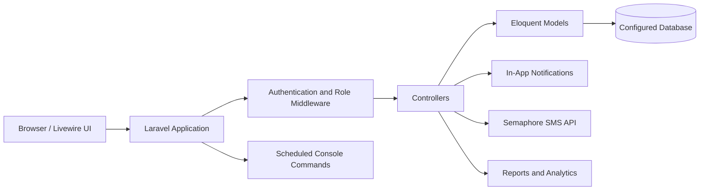

## Authentication and Role-Based Access

The application uses Laravel authentication and a custom role middleware. Three authenticated roles are supported: System Administrator, Official, and Health Worker.

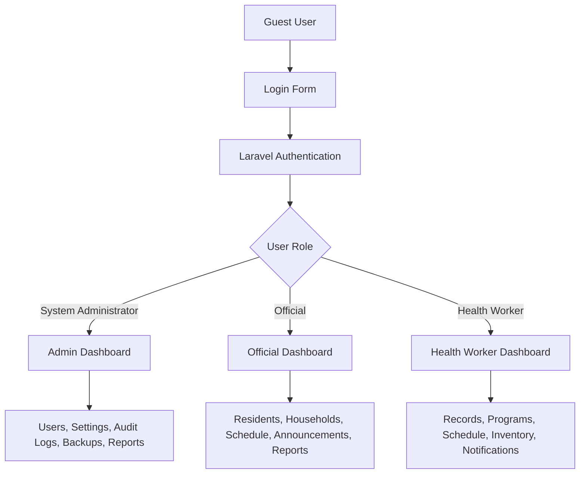

### Role Summary

| Role | Verified Access |
| --- | --- |
| System Administrator | Admin dashboard, users, settings, audit logs, backups, reports, analytics, records, programs, operations, medical inventory, announcements, schedule, and notifications. |
| Official | Official dashboard, residents, households, health records and visits, health programs, certificates, schedule, announcements, notifications, reports, and analytics. |
| Health Worker | Health Worker dashboard, residents, households, health records and visits, health programs, certificates, schedule, announcements, notifications, reports, analytics, and medical inventory. |

Medical inventory management is restricted to System Administrator and Health Worker. User management, settings, audit logs, and backups are restricted to System Administrator.

## Installation

For Windows with Laragon, use PowerShell or the Laragon terminal:

```powershell
composer install
Copy-Item .env.example .env
php artisan key:generate
php artisan migrate
npm install
npm run build
php artisan serve
```

Or use the Composer setup script:

```bash
composer run setup
```

On Unix-like shells, the equivalent setup commands are:

```bash
composer install
cp .env.example .env
php artisan key:generate
php artisan migrate
npm install
npm run build
php artisan serve
```

## Database Setup

The default database connection is SQLite. MySQL, MariaDB, PostgreSQL, and SQL Server can be configured through `.env`.

```bash
php artisan migrate
```

For testing:

```bash
php artisan test
```

Do not run database-changing commands against production data without a verified backup.

## Main Modules

- Residents
- Households
- Health Records
- Health Visits
- Immunization
- Maternal Care
- Child Health
- Senior Citizens
- Medical Inventory
- Certificates
- Announcements
- Schedule
- Notifications
- Reports
- Analytics
- Audit Logs
- Backups
- System Settings
- Users
- Database Assistant

## Authentication Workflow

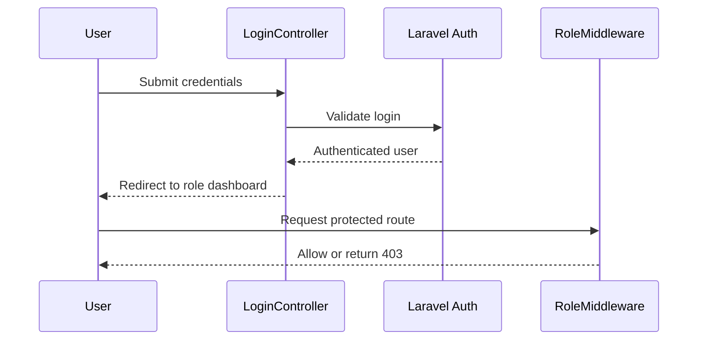

## User Management Workflow

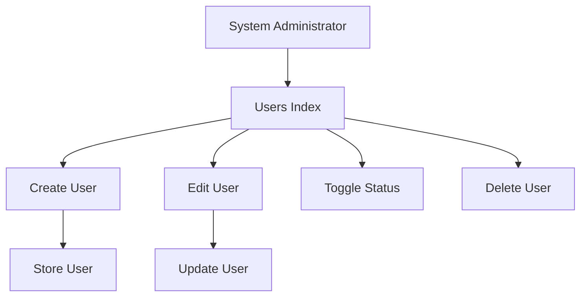

## Residents and Households Workflow

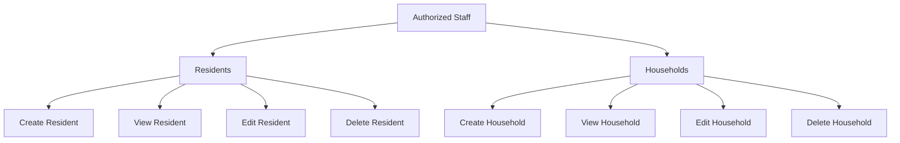

## Health Records and Health Visits Workflow

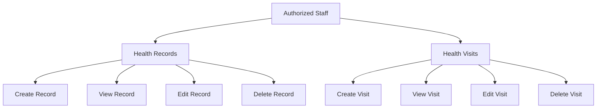

## Health Program Workflows

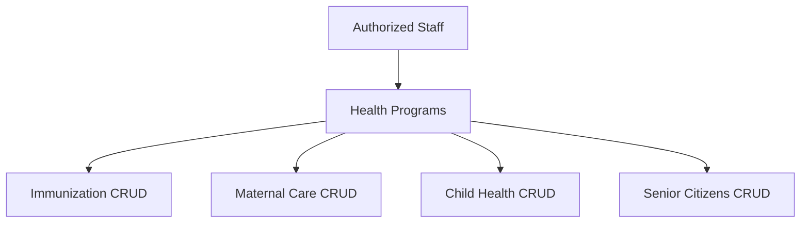

## Medical Inventory Workflow

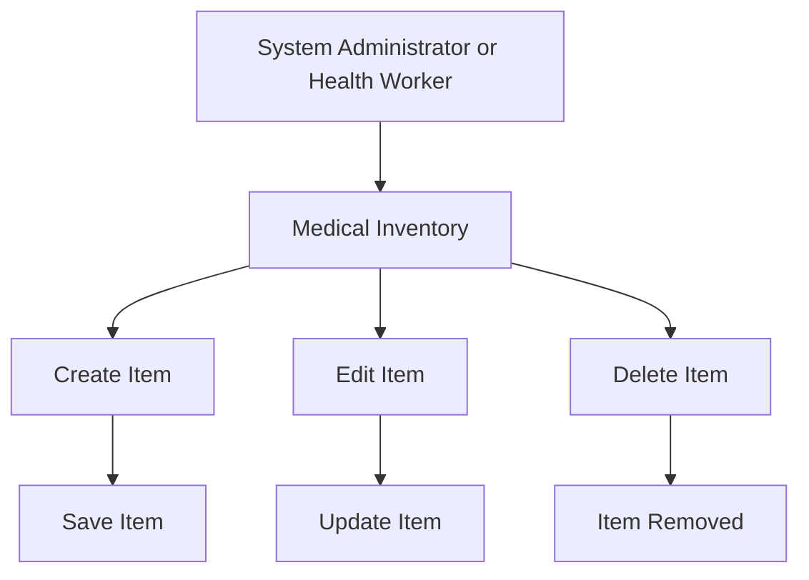

## Medical Inventory Notification Workflow

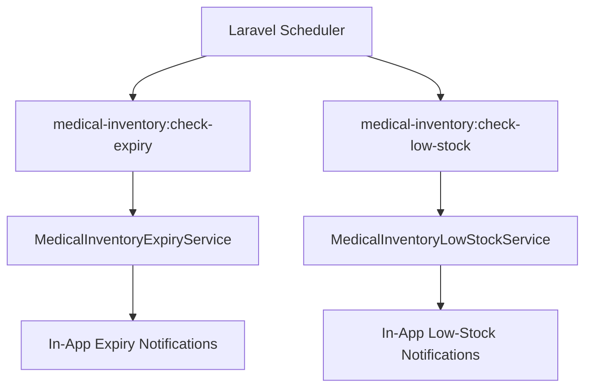

## Certificate Workflow

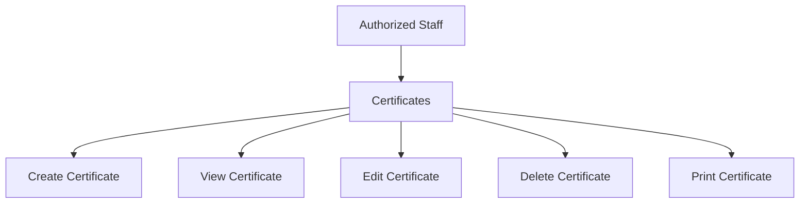

## Schedule and Event Notification Workflow

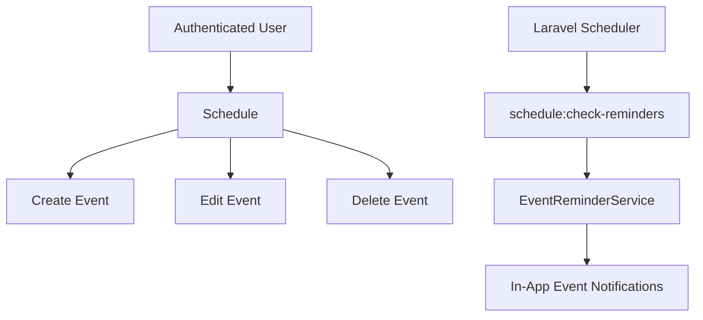

## Announcement and SMS Workflow

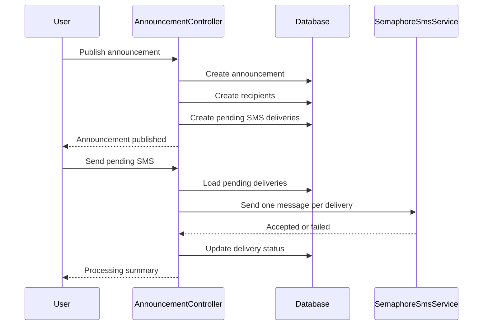

SMS sending requires `SEMAPHORE_SMS_ENABLED=true` and a configured `SEMAPHORE_API_KEY`. Delivery records without a contact number are marked as failed without calling the SMS provider.

## In-App Notification Workflow

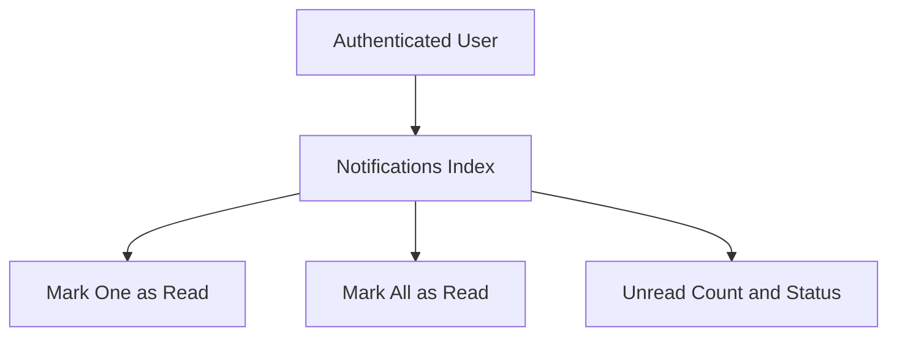

## Reports and Analytics Workflow

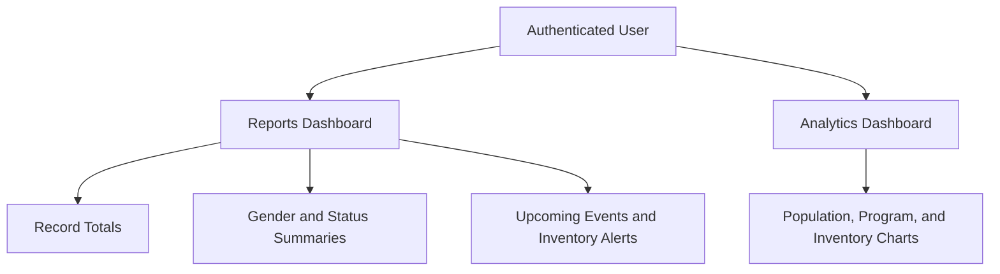

## Audit Log Workflow

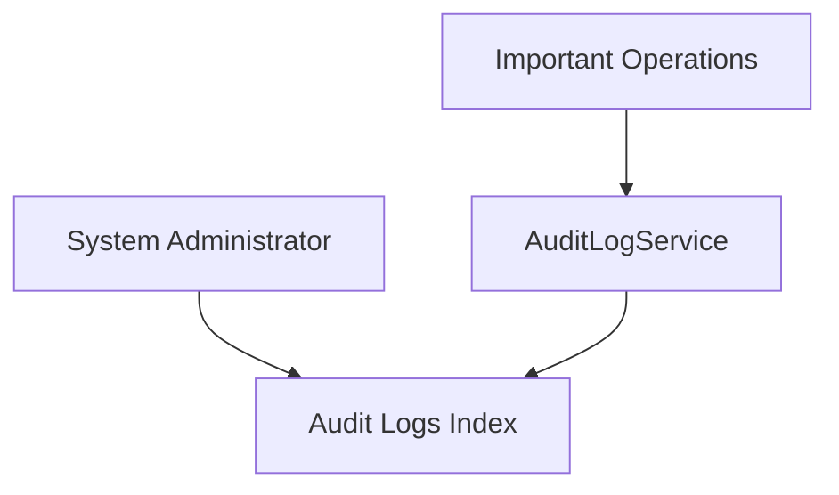

## Backup Workflow

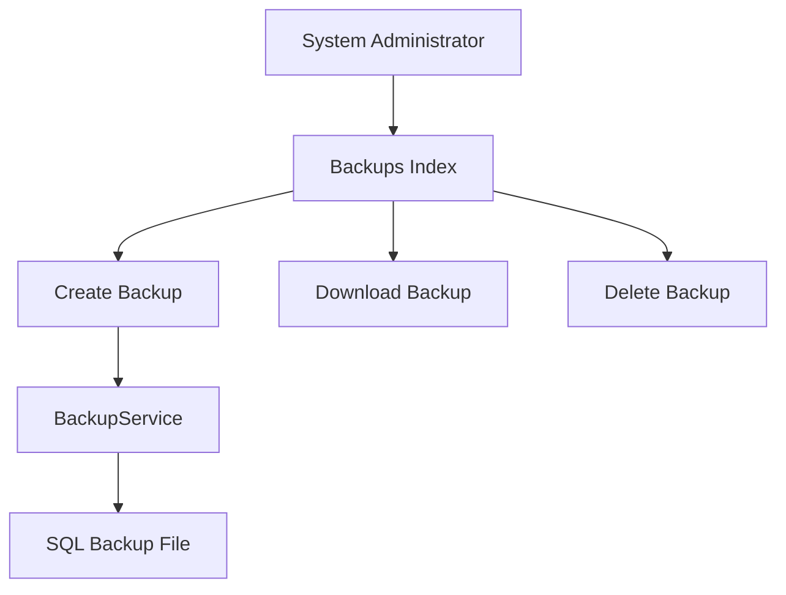

Backup restore is not implemented in the inspected routes or controller.

## System Settings and Account Workflow

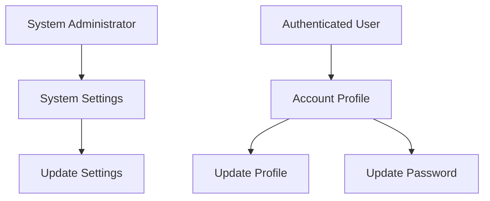

## Database Assistant Workflow

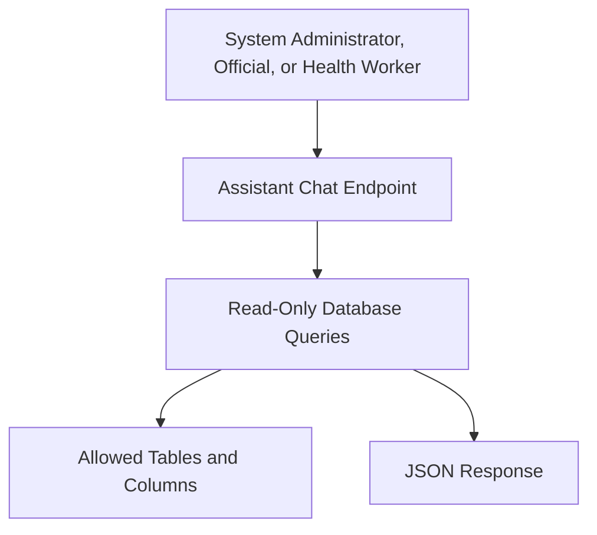

The assistant is implemented as a read-only, role-protected endpoint. It blocks sensitive tables and columns. External AI behavior depends on runtime configuration and should be verified separately.

## Database Relationships

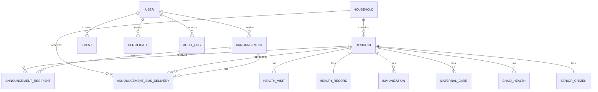

Additional relationships for medical inventory, certificates, events, notifications, and settings are defined in their migrations and models.

## Workflow Coverage Table

| Module | Workflow | Route/Entry Point | Main Controller/Component | Database or Service | Implementation Status |
| --- | --- | --- | --- | --- | --- |
| Authentication | Login and logout | `login`, `login.authenticate`, `logout` | `LoginController` | User model | Implemented |
| Authorization | Role-based route protection | `role` middleware | `RoleMiddleware` | User role | Implemented |
| Users | Create, view, edit, update, toggle status, delete | `users.*` | `UserController` | `users` table | Implemented |
| Residents | CRUD and view | `residents.*` | `ResidentController` | `residents` table | Implemented |
| Households | CRUD and view | `households.*` | `HouseholdController` | `households` table | Implemented |
| Health Records | CRUD and view | `health-records.*` | `HealthRecordController` | `health_records` table | Implemented |
| Health Visits | CRUD and view | `health-visits.*` | `HealthVisitController` | `health_visits` table | Implemented |
| Immunization | CRUD and view | `immunizations.*` | `ImmunizationController` | `immunizations` table | Implemented |
| Maternal Care | CRUD and view | `maternal-care.*` | `MaternalCareController` | `maternal_cares` table | Implemented |
| Child Health | CRUD and view | `child-health.*` | `ChildHealthController` | `child_healths` table | Implemented |
| Senior Citizens | CRUD and view | `senior-citizens.*` | `SeniorCitizenController` | `senior_citizens` table | Implemented |
| Medical Inventory | CRUD | `medical-inventories.*` | `MedicalInventoryController` | `medical_inventories` table | Implemented |
| Medical Inventory Alerts | Expiry and low-stock notifications | `medical-inventory:check-expiry`, `medical-inventory:check-low-stock` | Console commands and services | `MedicalInventoryExpiryService`, `MedicalInventoryLowStockService` | Implemented |
| Certificates | CRUD, view, print | `certificates.*`, `certificates.print` | `CertificateController` | `certificates` table | Implemented |
| Schedule | CRUD | `schedule.*` | `EventController` | `events` table | Implemented |
| Event Reminders | Scheduled event notifications | `schedule:check-reminders` | Console command and service | `EventReminderService` | Implemented |
| Announcements | Create, preview, publish, view | `announcements.*` | `AnnouncementController` | `announcements`, `announcement_recipients` tables | Implemented |
| Announcement SMS | Prepare and manually send pending SMS | `announcements.sms.send` | `AnnouncementController`, `SemaphoreSmsService` | `announcement_sms_deliveries` table | Partially Implemented |
| Notifications | View, mark read, mark all read | `notifications.*` | `NotificationController` | `notifications` table | Implemented |
| Reports | Reports dashboard | `reports.index` | `ReportController` | Multiple models | Implemented |
| Analytics | Analytics dashboard | `analytics.index` | `AnalyticsController` | Multiple models | Implemented |
| Audit Logs | View audit logs | `audit-logs.index` | `AuditLogController` | `audit_logs` table | Implemented |
| Backups | Create, download, delete | `backups.*` | `BackupController`, `BackupService` | SQL backup files | Implemented |
| Backups | Restore backup | Not present | Not implemented | Not applicable | Not Implemented |
| Settings | View and update settings | `settings.index`, `settings.update` | `SystemSettingController` | `system_settings` table | Implemented |
| Account | Update profile and password | `account.profile.update`, `account.password.update` | `AccountController` | `users` table | Implemented |
| Database Assistant | Read-only chat query endpoint | `assistant.chat` | `DatabaseAssistantController` | Allowed application tables | Implemented |
| Barangay Map | Not found in inspected code | Not present | Not implemented | Not applicable | Not Implemented |

## Configuration

Copy `.env.example` to `.env` and configure application, database, mail, and third-party service values. Do not commit real API keys, passwords, or production credentials.

SMS-related environment variables:

```env
SEMAPHORE_SMS_ENABLED=false
SEMAPHORE_API_KEY=
SEMAPHORE_SENDER_NAME=
```

## Scheduled Tasks

The application schedules the following commands in Philippine time:

```bash
php artisan medical-inventory:check-expiry
php artisan schedule:check-reminders
php artisan medical-inventory:check-low-stock
```

The scheduler must be started with:

```bash
php artisan schedule:work
```

or through the server's cron/task scheduler.

## Testing

```bash
php artisan test
```

Focused SMS tests:

```bash
php artisan test --filter SemaphoreSmsTest
php artisan test --filter AnnouncementSmsSafetyTest
```

## Audit Notes

This README was corrected against the inspected project files. Features are documented only when supported by routes, controllers, models, migrations, services, views, commands, or tests. Browser-level verification, real Semaphore SMS delivery, backup restore, export features, and any unimplemented features remain outside the current verified scope.

## About Laravel

Laravel is a web application framework with expressive, elegant syntax. We believe development must be an enjoyable and creative experience to be truly fulfilling. Laravel takes the pain out of development by easing common tasks used in many web projects, such as:

- [Simple, fast routing engine](https://laravel.com/docs/routing).
- [Powerful dependency injection container](https://laravel.com/docs/container).
- Multiple back-ends for [session](https://laravel.com/docs/session) and [cache](https://laravel.com/docs/cache) storage.
- Expressive, intuitive [database ORM](https://laravel.com/docs/eloquent).
- Database agnostic [schema migrations](https://laravel.com/docs/migrations).
- [Robust background job processing](https://laravel.com/docs/queues).
- [Real-time event broadcasting](https://laravel.com/docs/broadcasting).

Laravel is accessible, powerful, and provides tools required for large, robust applications.

## Learning Laravel

Laravel has the most extensive and thorough [documentation](https://laravel.com/docs) and video tutorial library of all modern web application frameworks, making it a breeze to get started with the framework.

In addition, [Laracasts](https://laracasts.com) contains thousands of video tutorials on a range of topics including Laravel, modern PHP, unit testing, and JavaScript. Boost your skills by digging into our comprehensive video library.

You can also watch bite-sized lessons with real-world projects on [Laravel Learn](https://laravel.com/learn), where you will be guided through building a Laravel application from scratch while learning PHP fundamentals.

## Agentic Development

Laravel's predictable structure and conventions make it ideal for AI coding agents like Claude Code, Cursor, and GitHub Copilot. Install [Laravel Boost](https://laravel.com/docs/ai) to supercharge your AI workflow:

```bash
composer require laravel/boost --dev
php artisan boost:install
```

Boost provides your agent 15+ tools and skills that help agents build Laravel applications while following best practices.

## Contributing

Thank you for considering contributing to the Laravel framework! The contribution guide can be found in the [Laravel documentation](https://laravel.com/docs/contributions).

## Code of Conduct

In order to ensure that the Laravel community is welcoming to all, please review and abide by the [Code of Conduct](https://laravel.com/docs/contributions#code-of-conduct).

## Security Vulnerabilities

If you discover a security vulnerability within Laravel, please send an e-mail to Taylor Otwell via [taylor@laravel.com](mailto:taylor@laravel.com). All security vulnerabilities will be promptly addressed.

## License

The Laravel framework is open-sourced software licensed under the [MIT license](https://opensource.org/licenses/MIT).