# WEB-BASED BARANGAY HEALTH CENTER RECORDS MANAGEMENT SYSTEM WITH DATA ANALYTICS, AUTOMATED REPORTING AND EVENT-DRIVEN NOTIFICATION

Barangay Esperanza Health Center Records Management System is a Laravel-based web application for Barangay Esperanza, Pilar, Sorsogon. It manages barangay health records, residents, households, health programs, schedules, announcements, medical inventory, reports, analytics, notifications, audit logs, backups, settings, and related operational workflows.

## Project Status

- **Implemented:** a public welcome page with database-backed aggregate charts; role-based authentication and authorization; System Administrator, Official, and Health Worker dashboards; user management; residents and households; health records and visits; health programs; medical inventory, stock releases, and alerts; schedules and event reminders; announcements and recipient targeting; SMS preparation and manual sending; in-app notifications; reports; analytics; audit logs; MySQL backups; system settings; account management; and a read-only database assistant endpoint.
- **Partially implemented:** UniSMS delivery tracking. The provider reports sending status, but its documented API does not explicitly confirm handset delivery.
- **Not implemented or not verified:** Barangay Map; backup restore; PDF/Excel export; automated report generation beyond the reports dashboard; and any feature not present in the inspected routes, controllers, models, migrations, views, services, or tests.

## Technology Stack

- PHP 8.3 or later (PHP 8.x)
- Composer and Node.js (`^20.19.0` or `>=22.12.0` for the installed Vite 8)
- Laravel 13
- Livewire 4
- Blade templates
- Tailwind CSS 4
- Alpine.js
- Vite for frontend assets
- SQLite by default; MySQL and other Laravel database connections can be configured through `.env` (see database limitations below)
- PHPUnit for automated tests

## System Architecture

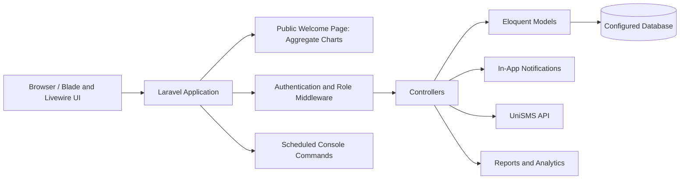

## Authentication and Role-Based Access

The application uses Laravel authentication and a custom role middleware. Three authenticated roles are supported: System Administrator, Official, and Health Worker.

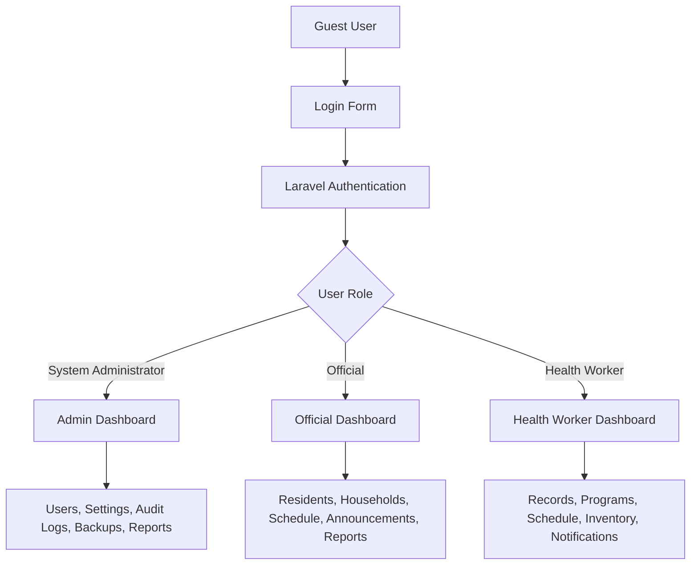

### Role Summary

| Role | Verified Access |
| --- | --- |
| System Administrator | Admin dashboard, users, settings, audit logs, backups, reports, analytics, records, programs, operations, medical inventory, announcements, schedule, and notifications. |
| Official | Official dashboard, residents, households, health records and visits, health programs, schedule, announcements, notifications, reports, and analytics. |
| Health Worker | Health Worker dashboard, residents, households, health records and visits, health programs, schedule, announcements, notifications, reports, analytics, and medical inventory. |

Medical inventory management is restricted to System Administrator and Health Worker. User management, settings, audit logs, and backups are restricted to System Administrator.

## Installation

Install PHP with the required Composer and database extensions, Composer, and Node.js. The following commands are for a **new local installation**. If `.env` already contains an application key, preserve it and skip `php artisan key:generate`; do not overwrite the existing `.env`.

For Windows with Laragon, use PowerShell or the Laragon terminal:

```powershell
composer install
if (-not (Test-Path .env)) { Copy-Item .env.example .env }
php artisan key:generate
# For the default SQLite connection, create the database file if it is missing:
if (-not (Test-Path database\database.sqlite)) { New-Item -ItemType File database\database.sqlite }
# For MySQL instead, configure DB_* in .env and create the database before migrating.
php artisan migrate
npm install
npm run build
php artisan serve
```

For a new installation, `composer run setup` also installs dependencies (`npm install --ignore-scripts`), creates `.env` if missing, generates a key, migrates with `--force`, and builds assets. Configure the database first and ensure its SQLite file or MySQL database exists. Use an appropriate development database and do not run this script on an existing installation without reviewing those effects:

```bash
composer run setup
```

On Unix-like shells, the equivalent setup commands are:

```bash
composer install
test -f .env || cp .env.example .env
php artisan key:generate
# For the default SQLite connection:
test -f database/database.sqlite || touch database/database.sqlite
# For MySQL instead, configure DB_* in .env and create the database before migrating.
php artisan migrate
npm install
npm run build
php artisan serve
```

## Database Setup

The default connection in `.env.example` is SQLite. MySQL, MariaDB, PostgreSQL, and SQL Server connections are also defined, but that does **not** mean every feature supports every engine. The analytics dashboard uses MySQL-style `DATE_FORMAT`; the backup service reads the MySQL connection and uses `mysqldump`. Use MySQL for those features or verify compatibility before using another engine. Tests use an in-memory SQLite database.

```bash
php artisan migrate
```

For testing:

```bash
php artisan test
```

The setup commands do not seed users. `DatabaseSeeder` invokes `UserSeeder`, which contains development administrator credentials and uses `updateOrCreate`, so reseeding can reset those accounts. Do not use the development seeder in production; provision administrator accounts securely. Do not run database-changing commands against production data without a verified backup.

## Main Modules

- Residents
- Households
- Health Records
- Health Visits
- Immunization
- Maternal Care
- Child Health
- Senior Citizens
- Medical Inventory
- Announcements
- Schedule
- Notifications
- Reports
- Analytics
- Audit Logs
- Backups
- System Settings
- Users
- Database Assistant

## Public Welcome Page

The public `home` route renders the welcome page and a responsive carousel using current database aggregates loaded when the page is requested. It shows:

- Current-year monthly health visits, including exact counts below five.
- Resident gender and status distributions; each entire distribution is withheld when a nonzero group contains fewer than five residents.
- Resident and household totals, event and upcoming-event totals, inventory entry counts, and a combined health/program entry count. The health/program total is withheld when it is below five; it counts entries, not unique patients.

The carousel advances every two seconds, with previous/next buttons. Rotation pauses on pointer hover, touch-and-hold, keyboard focus, a hidden browser tab, or a reduced-motion preference. The charts do not automatically reload database data while the page remains open.

**Privacy:** The welcome page is accessible without signing in. Monthly visit counts and the other displayed aggregates are public, including small monthly visit counts. Review the disclosure risk before publishing or deploying real health data. Individual patient names and visit details are not part of these public charts. The full analytics and reports dashboards require authentication.

## Authentication Workflow

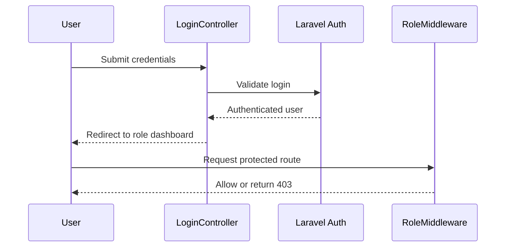

## User Management Workflow

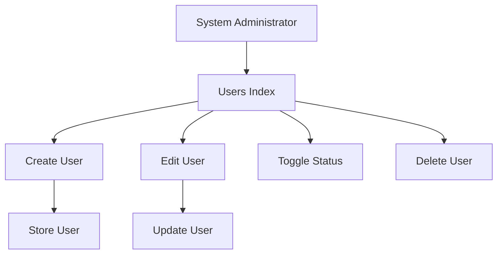

## Residents and Households Workflow

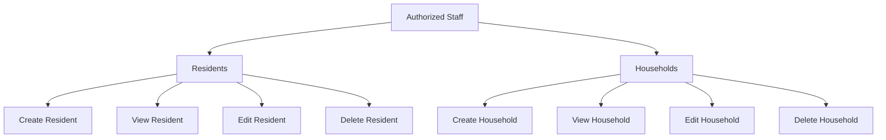

## Health Records and Health Visits Workflow

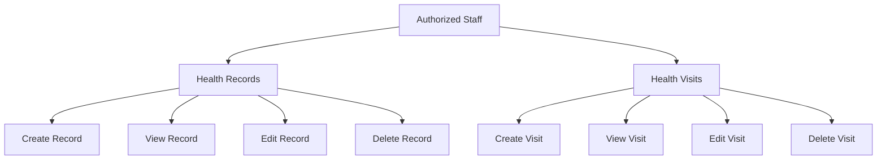

## Health Program Workflows

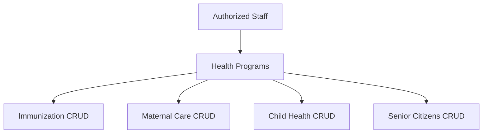

## Medical Inventory Workflow

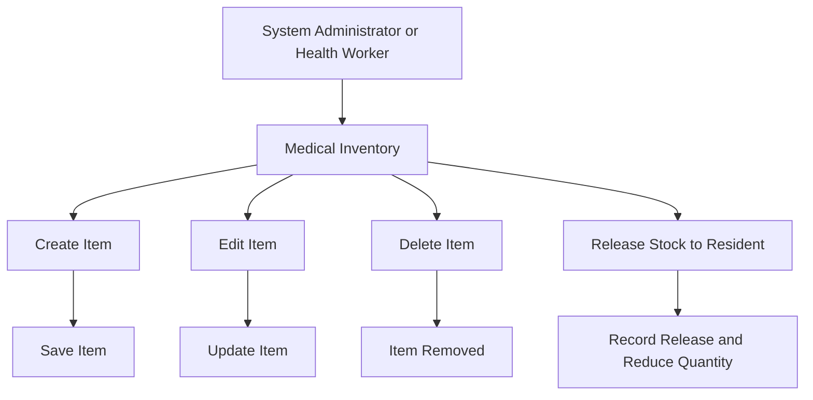

Stock releases require confirmation and cannot exceed available quantity or use expired inventory. The release records the resident, staff member, method, purpose, quantity, and time.

## Medical Inventory Notification Workflow

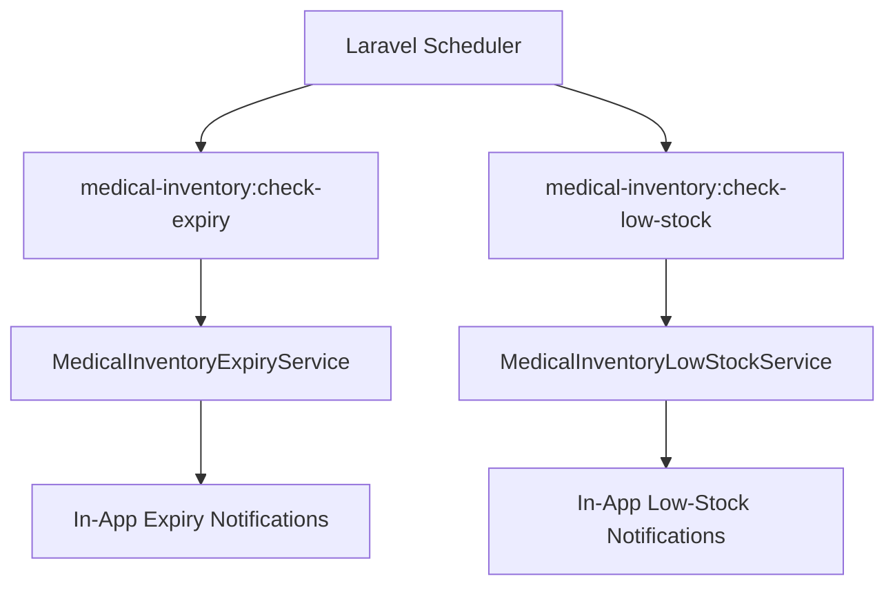

## Schedule and Event Notification Workflow

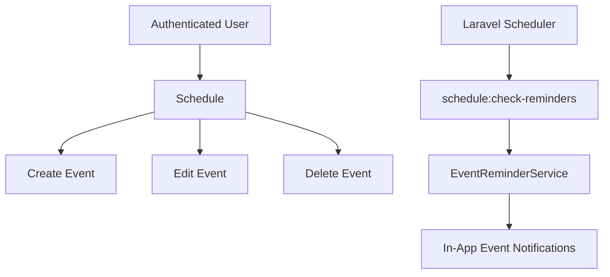

## Announcement and SMS Workflow

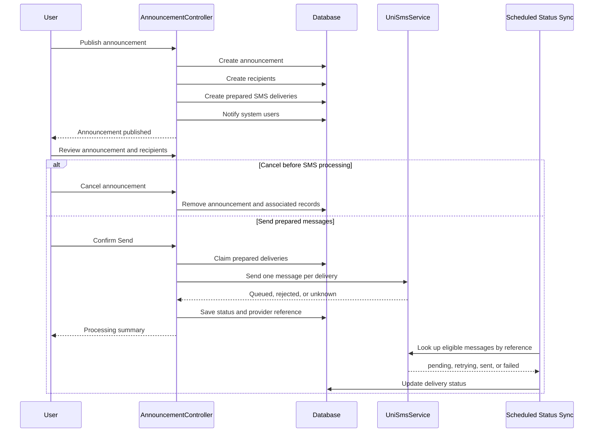

The Published Announcements list displays three records per page. Publishing creates the announcement, recipient records, prepared SMS deliveries, and in-app notifications for system users; it does not send SMS. The details page shows the announcement, audience, recipient counts, delivery summary, and a separate send confirmation. Cancel removes the announcement, prepared deliveries, and associated in-app notifications only if SMS processing has not started; users may already have seen the notification.

SMS sending requires `UNISMS_SMS_ENABLED=true`, `UNISMS_SECRET_KEY`, and `UNISMS_SENDER_ID`. A queued response remains Pending; an ambiguous submission is Unknown and is not automatically resent. Provider `sent` is displayed separately and does not confirm handset delivery. The disabled **Sent** button indicates that all prepared deliveries were submitted, not that every handset received a message. The details page no longer exposes manual status-check or retry controls, although the authenticated backend routes remain.

To receive provider updates, set `UNISMS_WEBHOOK_SECRET` to the webhook secret configured in UniSMS and configure the provider's HTTPS webhook URL to the application's `/webhooks/unisms` path. The scheduled status sync can also check eligible messages with provider references. A webhook that arrives before its reference is saved may need a later status check. Verify any unknown outcome with UniSMS before sending another message.

Webhooks match the documented message reference, not a unique event ID. Webhook updates to the same delivery use a transaction and row lock on MySQL; repeated sent or retrying states and protected final states are acknowledged without rewriting the delivery. A failed update returns an error so it can be retried. Failed and Delivered cannot be overwritten, retrying cannot replace a provider-sent status, and a failed notification can replace sent/Unknown. UniSMS does not document webhook event ordering or retry identifier stability, so this is not event deduplication and arrival order cannot establish the latest provider event.

Status checks use the provider's status API directly and work on localhost when the server can reach UniSMS; they only look up existing messages and never send SMS. A check already in progress blocks another check for the same announcement. Missing or invalid references are reported, and temporary lookup errors leave the last known status unchanged. Sanitized provider reasons and error codes are retained in status-check history when available. The retained manual-check endpoint bypasses per-message intervals but respects the provider-error cooldown.

The Laravel scheduler checks up to 25 due Pending or Unknown messages with valid references every five minutes, including sent-but-unconfirmed messages, and checks messages older than a day at most hourly. The command reports updated, skipped, not-yet-due, unavailable, missing-reference, invalid-reference and locked counts. Eligibility counts reflect the start of the run; the next eligibility time is recalculated afterward and does not guarantee when the scheduler or provider cooldown will allow a check. Run the Laravel scheduler on the host for automatic checks; on a local development machine, `php artisan schedule:work` runs it while the command remains active. Failed lookups are recorded without changing the last valid provider status. The retained retry-preparation endpoint accepts only eligible explicit rejections; it does not send SMS. Pending, accepted, and uncertain submissions cannot be retried through it.

### Enable scheduled checks

The SMS status command only performs provider lookups; it does not send SMS. Laravel's scheduler also runs the other configured inventory and event-reminder tasks. Use **one** scheduler method per host and check for an existing scheduler before starting another.

For local Laragon development, open PowerShell in the application directory and keep it open:

```powershell
php artisan schedule:work --no-interaction
```

For automatic execution while Windows and the configured user account are available:

1. Check Windows Task Scheduler for an existing task running this application's `artisan schedule:run`; do not create a duplicate.
2. Create a task that repeats every minute indefinitely. Set its action to **Start a program**. Use the PHP executable path from `Get-Command php` as the program, `artisan schedule:run --no-interaction` as its arguments, and the application root (for this installation, `C:\laragon\www\EWebsite`) as **Start in**.
3. Configure the task not to start another instance while one is already running. Verify its last run result and, if needed, inspect the stored delivery status-check records. The machine and database must be available; task execution also depends on the selected Windows account and login settings.

For a Unix production host, configure the application directory and PHP executable for the cron user, then add one per-minute scheduler entry (replace both placeholders with absolute paths):

```cron
LARAVEL_APP_DIR="REPLACE_WITH_ABSOLUTE_APPLICATION_DIRECTORY"
PHP_EXECUTABLE="REPLACE_WITH_ABSOLUTE_PHP_EXECUTABLE"
* * * * * cd "$LARAVEL_APP_DIR" && "$PHP_EXECUTABLE" artisan schedule:run --no-interaction
```

Check `php artisan schedule:list --no-interaction` for registered tasks. A listed task alone does not mean the host scheduler is running. If UniSMS still reports Pending, the application retains Pending; provider acceptance or `sent` does not confirm handset delivery.

## In-App Notification Workflow

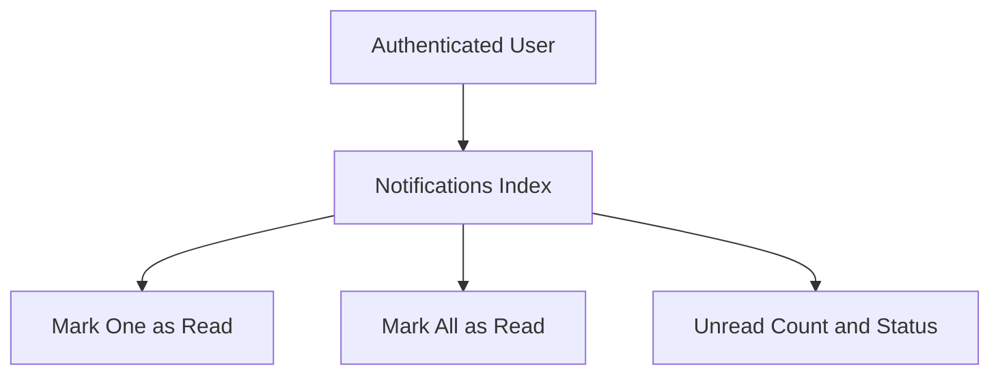

## Reports and Analytics Workflow

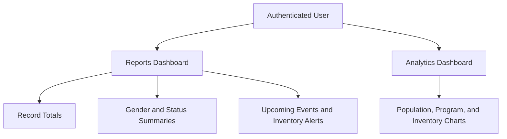

## Audit Log Workflow

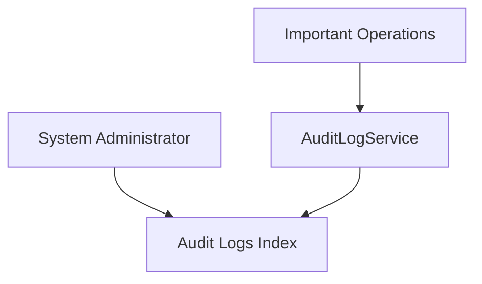

## Backup Workflow

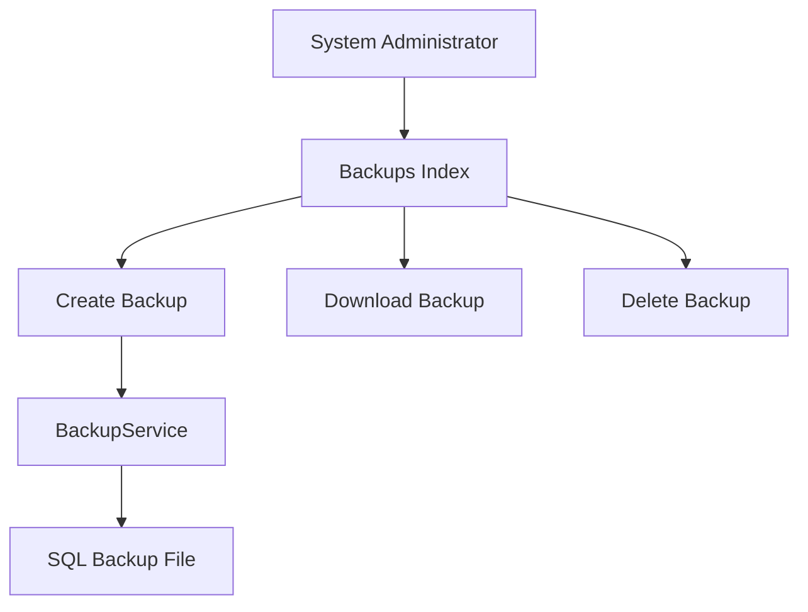

The backup service reads the MySQL connection configuration, even if another database is the default, and writes SQL files to `storage/app/private/backups`. Set `MYSQLDUMP_PATH` to an existing `mysqldump` executable; otherwise the service looks for its configured Laragon MySQL 8.4.3 executable path. It does not back up SQLite or implement restore.

## System Settings and Account Workflow

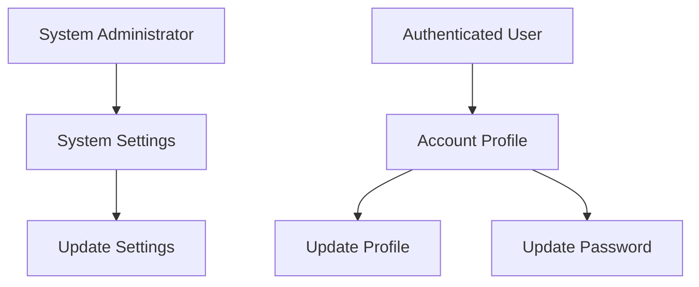

## Database Assistant Workflow

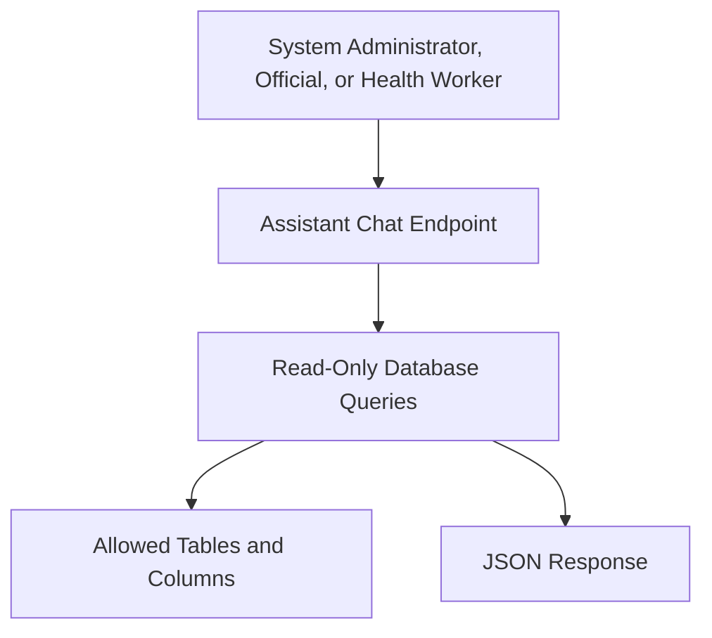

The assistant is implemented as a read-only, role-protected endpoint. It blocks sensitive tables and columns. External AI behavior depends on runtime configuration and should be verified separately.

## Database Relationships

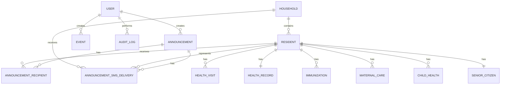

Additional relationships for medical inventory, events, notifications, and settings are defined in their migrations and models. The retired certificates table and its historical records are retained.

## Workflow Coverage Table

| Module | Workflow | Route/Entry Point | Main Controller/Component | Database or Service | Implementation Status |
| --- | --- | --- | --- | --- | --- |
| Welcome Page | Public aggregate charts and carousel | `home` | `WelcomeController` | Multiple models | Implemented |
| Authentication | Login and logout | `login`, `login.authenticate`, `logout` | `LoginController` | User model | Implemented |
| Authorization | Role-based route protection | `role` middleware | `RoleMiddleware` | User role | Implemented |
| Users | Create, view, edit, update, toggle status, delete | `users.*` | `UserController` | `users` table | Implemented |
| Residents | CRUD and view | `residents.*` | `ResidentController` | `residents` table | Implemented |
| Households | CRUD and view | `households.*` | `HouseholdController` | `households` table | Implemented |
| Health Records | CRUD and view | `health-records.*` | `HealthRecordController` | `health_records` table | Implemented |
| Health Visits | CRUD and view | `health-visits.*` | `HealthVisitController` | `health_visits` table | Implemented |
| Immunization | CRUD and view | `immunizations.*` | `ImmunizationController` | `immunizations` table | Implemented |
| Maternal Care | CRUD and view | `maternal-care.*` | `MaternalCareController` | `maternal_cares` table | Implemented |
| Child Health | CRUD and view | `child-health.*` | `ChildHealthController` | `child_healths` table | Implemented |
| Senior Citizens | CRUD and view | `senior-citizens.*` | `SeniorCitizenController` | `senior_citizens` table | Implemented |
| Medical Inventory | List, create, update, delete, and release stock | `medical-inventories.*` | `MedicalInventoryController` | Inventory and stock transaction tables | Implemented |
| Medical Inventory Alerts | Expiry and low-stock notifications | `medical-inventory:check-expiry`, `medical-inventory:check-low-stock` | Console commands and services | `MedicalInventoryExpiryService`, `MedicalInventoryLowStockService` | Implemented |
| Schedule | CRUD | `schedule.*` | `EventController` | `events` table | Implemented |
| Event Reminders | Scheduled event notifications | `schedule:check-reminders` | Console command and service | `EventReminderService` | Implemented |
| Announcements | Create, preview, publish, view, cancel before SMS processing, and delete | `announcements.*` | `AnnouncementController` | `announcements`, `announcement_recipients` tables | Implemented |
| Announcement SMS | Prepare, confirm sending, and synchronize provider status | `announcements.sms.send`, `announcements:sync-sms-status` | `AnnouncementController`, `UniSmsService` | `announcement_sms_deliveries` table | Partially Implemented |
| Notifications | View, mark read, mark all read | `notifications.*` | `NotificationController` | `notifications` table | Implemented |
| Reports | Reports dashboard | `reports.index` | `ReportController` | Multiple models | Implemented |
| Analytics | Analytics dashboard | `analytics.index` | `AnalyticsController` | Multiple models | Implemented |
| Audit Logs | View audit logs | `audit-logs.index` | `AuditLogController` | `audit_logs` table | Implemented |
| Backups | Create, download, delete | `backups.*` | `BackupController`, `BackupService` | SQL backup files | Implemented |
| Backups | Restore backup | Not present | Not implemented | Not applicable | Not Implemented |
| Settings | View and update settings | `settings.index`, `settings.update` | `SystemSettingController` | `system_settings` table | Implemented |
| Account | Update profile and password | `account.profile.update`, `account.password.update` | `AccountController` | `users` table | Implemented |
| Database Assistant | Read-only chat query endpoint | `assistant.chat` | `DatabaseAssistantController` | Allowed application tables | Implemented |
| Barangay Map | Not found in inspected code | Not present | Not implemented | Not applicable | Not Implemented |

## Configuration

Copy `.env.example` to `.env` and configure application, database, mail, and third-party service values. Do not commit real API keys, passwords, or production credentials.

SMS-related environment variables:

```env
UNISMS_SMS_ENABLED=false
UNISMS_SECRET_KEY=
UNISMS_SENDER_ID=
UNISMS_WEBHOOK_SECRET=
UNISMS_BASE_URL=https://unismsapi.com/api
```

For MySQL backups, set `MYSQLDUMP_PATH` to the absolute path of the executable when it is not at the service's Laragon fallback path.

## Scheduled Tasks

| Command | Schedule |
| --- | --- |
| `medical-inventory:check-expiry` | Daily at 08:00 Asia/Manila |
| `schedule:check-reminders` | Daily at 08:00 Asia/Manila |
| `medical-inventory:check-low-stock` | Every 30 minutes; configured for Asia/Manila |
| `announcements:sync-sms-status` | Every five minutes |

Start the scheduler locally with:

```bash
php artisan schedule:work
```

Alternatively, run `schedule:run` every minute through the server's cron or task scheduler, as described above.

## Testing

```bash
php artisan test
```

Focused tests for the welcome analytics, announcement SMS workflow, and stock releases:

```bash
php artisan test tests/Feature/WelcomeAnalyticsTest.php
php artisan test tests/Feature/AnnouncementSmsSafetyTest.php
php artisan test tests/Feature/AnnouncementTargetingTest.php
php artisan test tests/Feature/MedicalInventoryStockOutTest.php
```

## About Laravel

Laravel is a web application framework with expressive, elegant syntax. We believe development must be an enjoyable and creative experience to be truly fulfilling. Laravel takes the pain out of development by easing common tasks used in many web projects, such as:

- [Simple, fast routing engine](https://laravel.com/docs/routing).
- [Powerful dependency injection container](https://laravel.com/docs/container).
- Multiple back-ends for [session](https://laravel.com/docs/session) and [cache](https://laravel.com/docs/cache) storage.
- Expressive, intuitive [database ORM](https://laravel.com/docs/eloquent).
- Database agnostic [schema migrations](https://laravel.com/docs/migrations).
- [Robust background job processing](https://laravel.com/docs/queues).
- [Real-time event broadcasting](https://laravel.com/docs/broadcasting).

Laravel is accessible, powerful, and provides tools required for large, robust applications.

## Learning Laravel

Laravel has the most extensive and thorough [documentation](https://laravel.com/docs) and video tutorial library of all modern web application frameworks, making it a breeze to get started with the framework.

In addition, [Laracasts](https://laracasts.com) contains thousands of video tutorials on a range of topics including Laravel, modern PHP, unit testing, and JavaScript. Boost your skills by digging into our comprehensive video library.

You can also watch bite-sized lessons with real-world projects on [Laravel Learn](https://laravel.com/learn), where you will be guided through building a Laravel application from scratch while learning PHP fundamentals.

## Agentic Development

Laravel Boost is included as a development dependency. See the [Laravel AI documentation](https://laravel.com/docs/ai) for its development tools.

## Contributing

Run the relevant application tests before submitting changes. Laravel's framework contribution guidance is available in the [Laravel documentation](https://laravel.com/docs/contributions).

## Code of Conduct

In order to ensure that the Laravel community is welcoming to all, please review and abide by the [Code of Conduct](https://laravel.com/docs/contributions#code-of-conduct).

## License

The Composer package metadata specifies the [MIT license](https://opensource.org/licenses/MIT).